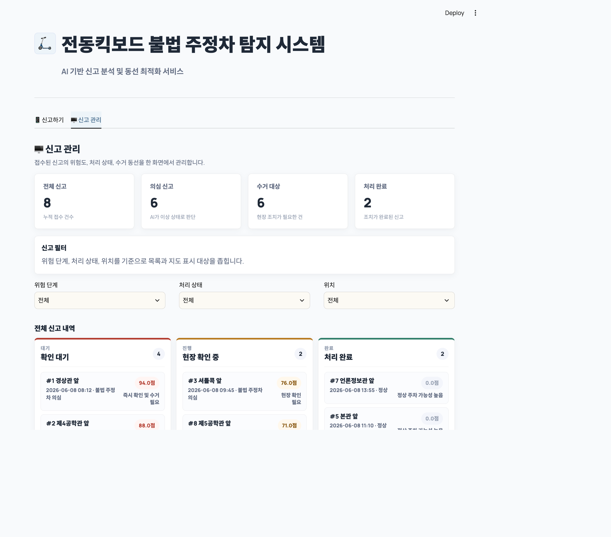
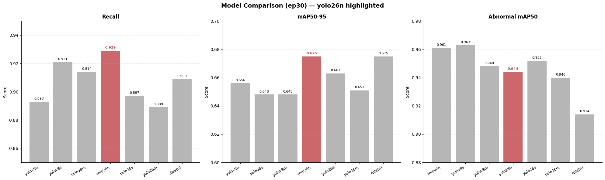
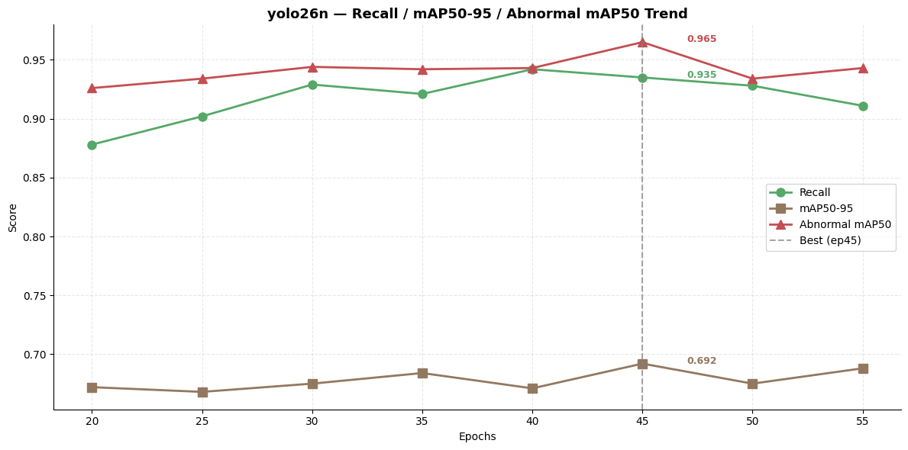
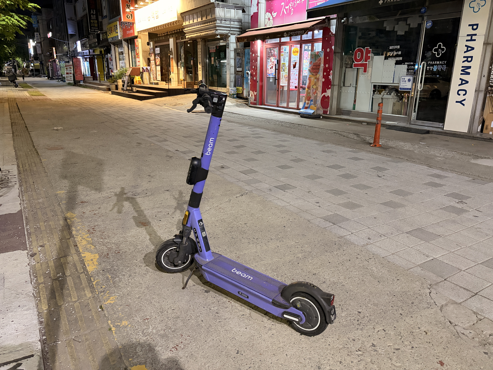
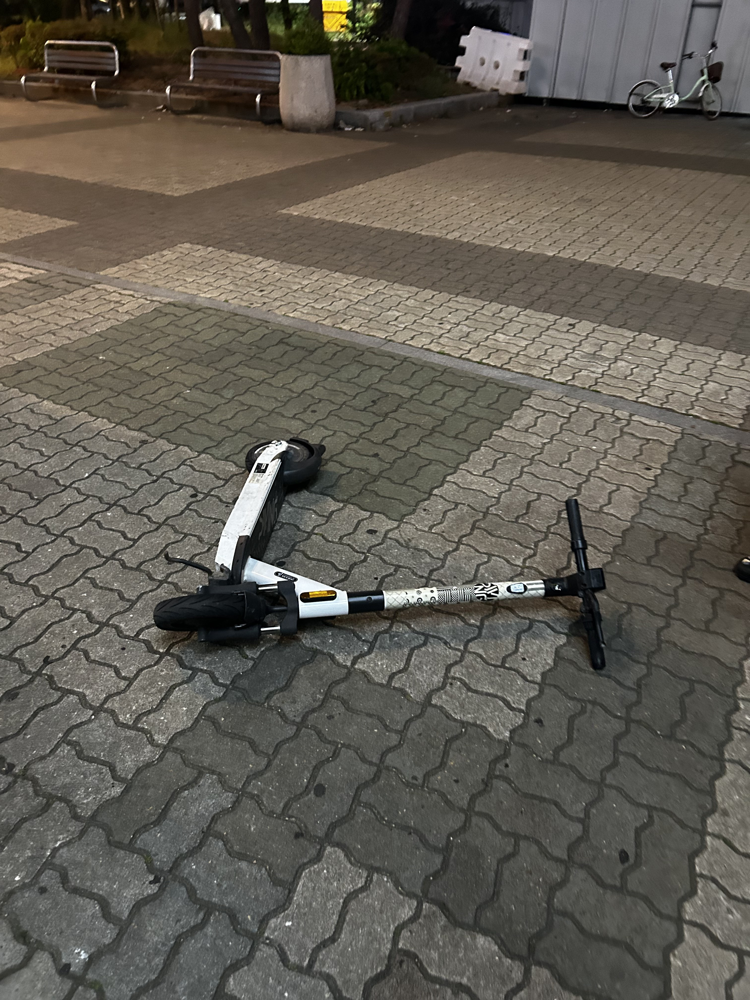
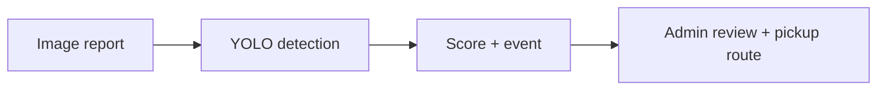

# Scooter Parking Detection

A prototype that connects scooter parking detection to report management and pickup route planning.

**Object detection · Streamlit · Geospatial visualization**

[Demo](#application-preview) · [Results](#recorded-experiments) · [Run](#getting-started) · [Implementation](dashboard/app.py)

## Application Preview



Actual screenshot of the unmodified Streamlit application running locally with its eight built-in demonstration events. Counts, scores, and statuses in this preview are demo data; no detector checkpoint was used to produce them.

## Overview

The application accepts a reported image and location, detects normal or abnormal parking, and turns the result into a scored event. An administrator view supports filtering reports, tracking their status, and planning a pickup route across predefined campus locations.

The repository includes the dashboard, inference and scoring logic, route planning, experiment notebooks, and sample images. Trained detector weights are not included.

## Recorded Experiments

The committed notebooks contain **26 recorded test evaluations** across seven detector variants and several training durations. The evaluation function explicitly uses `split="test"`; its logs report **204 test images and 217 annotated instances**.

### Comparison at 30 training epochs

| Detector | mAP50 | mAP50–95 | Precision | Recall |
| :--- | ---: | ---: | ---: | ---: |
| YOLOv8n | 0.935 | 0.656 | 0.930 | 0.893 |
| YOLOv8s | 0.945 | 0.648 | 0.903 | 0.921 |
| YOLOv8m | 0.924 | 0.648 | 0.845 | 0.914 |
| YOLO26n | 0.944 | 0.675 | 0.918 | 0.929 |
| YOLO26s | 0.941 | 0.663 | 0.928 | 0.897 |
| YOLO26m | 0.936 | 0.651 | 0.919 | 0.889 |
| RT-DETR-L | 0.921 | 0.675 | 0.935 | 0.909 |



### Additional YOLO26n epoch sweep

The 45-epoch run has the highest recorded mAP50–95 among the 26 saved evaluations: **0.692**, with mAP50 **0.964**, precision **0.931**, and recall **0.935**.



These are saved notebook outputs, not newly rerun experiments. Models and training durations were compared using the same test split, so this is an exploratory comparison rather than a final evaluation on an untouched model-selection holdout. The dashboard's separately supplied `best.pt` is not identified by these tables.

**Sources:** [YOLO notebook](notebooks/exp_yolo.ipynb) · [RT-DETR notebook](notebooks/exp_rtdetr.ipynb) · [All 26 recorded results](assets/recorded_test_results.csv)

The graphs above were exported directly from the existing YOLO notebook without changing their values.

## Example Inputs

These are repository sample inputs, not model predictions or evidence of detection accuracy.

<table>
<tr>
<td align="center"><br>Normal parking sample</td>
<td align="center"><br>Abnormal parking sample</td>
</tr>
</table>

## Workflow



### Detection and scoring

[Detector](src/detector.py) loads a YOLO checkpoint and collects bounding boxes, labels, and confidence values. It chooses an abnormal prediction first when the maximum abnormal confidence reaches 0.5; otherwise it checks normal confidence, then returns `none` if neither reaches the threshold.

[RiskScorer](src/risk_scorer.py) converts the maximum abnormal confidence into a score:

```text
score = round(maximum abnormal confidence × 100, 1)
```

| Score | Display level | Suggested action |
| :--- | :--- | :--- |
| 80–100 | Very high | Immediate review and pickup |
| 50–<80 | High | On-site review |
| 30–<50 | Low | Monitor |
| 0–<30 | Normal | Likely normal parking |

This is a confidence-based prioritization heuristic, not a calibrated measure of physical danger or a legal determination of a parking violation.

### Pickup route planning

The route planner selects reports with an `abnormal` prediction, score of at least 50, and a known location.

- Default start: the campus main building.
- Up to eight targets: exhaustive search for the shortest visit order under the implemented distance approximation.
- More than eight targets: a nearest-neighbor heuristic.
- Distances: planar estimates between fixed coordinates, without road or pedestrian-network routing.
- The route is an open path; it does not include a return trip to the start.

## Getting Started

Run commands from the repository root. Use Python 3.10 or later.

```bash
git clone https://github.com/yunakinn/scooter-anomaly-detection.git
cd scooter-anomaly-detection
python -m venv .venv
source .venv/bin/activate
python -m pip install streamlit ultralytics folium streamlit-folium plotly pandas
```

There is currently no dependency manifest or pinned environment in this repository. The command above lists the application's directly imported third-party packages; it is not a tested lockfile.

### Start the dashboard

```bash
streamlit run dashboard/app.py
```

The dashboard starts with eight hard-coded demonstration events. These illustrate the administrator workflow; their scores are not evaluation results. Submitting a new image for analysis additionally requires detector weights.

### Enable image inference

Place a compatible trained YOLO checkpoint at:

```text
weights/best.pt
```

Or provide its path when launching:

```bash
MODEL_PATH=/absolute/path/to/best.pt streamlit run dashboard/app.py
```

The detector expects class names `normal` and `abnormal`. If checkpoint class names are unavailable, the fallback mapping is 0 → normal and 1 → abnormal.

The map optionally reads `VWORLD_API_KEY`; otherwise it uses the fallback tiles configured in [map_tiles.py](dashboard/map_tiles.py).

## Repository Guide

| Path | Purpose |
| :--- | :--- |
| [dashboard/](dashboard/) | Report submission, administrator view, styling, and maps |
| [src/detector.py](src/detector.py) | YOLO inference and annotated results |
| [src/risk_scorer.py](src/risk_scorer.py) | Confidence-to-score mapping and action levels |
| [src/event_system.py](src/event_system.py) | Event creation and report locations |
| [src/route_optimizer.py](src/route_optimizer.py) | Target selection and visit ordering |
| [src/visualization.py](src/visualization.py) | Event statistics and charts |
| [notebooks/](notebooks/) | Data processing and YOLO / RT-DETR experiment notebooks |
| [data/demo_images/](data/demo_images/) | Sample input images |
| [dataset.yaml](dataset.yaml) | Training dataset configuration requiring local paths |

## Current Scope and Limitations

- Recorded test metrics come from the committed experiment notebooks. Dashboard demonstration events and sample inputs are separate from those evaluations.
- Report state is held in Streamlit session state rather than a persistent database. Uploaded images are saved locally under `data/uploaded_images/`.
- Locations and route assumptions are specific to the predefined campus map.
- Reproducing model training requires the dataset and an appropriate training setup beyond the included sample images.


