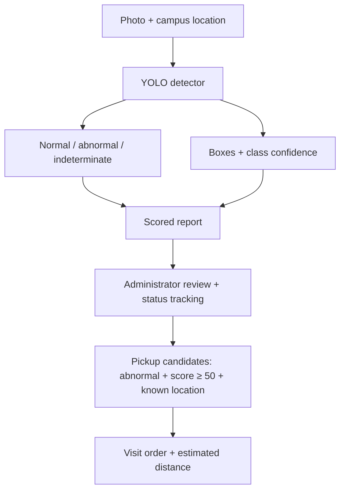

# Scooter Parking Detection

**From a parking photo to a report and a pickup route.**

Object detection · Streamlit dashboard · Geospatial visualization

[Workflow](#system-workflow) · [Results](#recorded-results) · [Quick start](#quick-start) · [Repository guide](#repository-guide)

A campus scooter-parking prototype that combines image-based detection with report management and pickup route planning. Users submit a photo and location; administrators review the resulting reports, update their status, and plan a route across predefined campus locations.

## At a Glance

| Component | Scope |
| :--- | :--- |
| Detection | YOLO checkpoint · `normal`, `abnormal`, or indeterminate |
| Application | Photo submission, annotated detections, report filtering, status tracking, and pickup routes |
| Recorded experiments | 7 detector variants · 26 saved test evaluations · 204 test images / 217 annotated instances |
| Highest recorded mAP50–95 | **0.692** · YOLO26n, 45 epochs · exploratory comparison |
| Included / required | Dashboard, inference logic, notebooks, and sample images included; trained detector weights required for new image analysis |

## System Workflow



The application uses a YOLO checkpoint for inference. RT-DETR appears in the experiment comparison below; it is not the dashboard's inference backend.

| Stage | Implementation |
| :--- | :--- |
| Submit | Save an uploaded image and select a predefined campus location |
| Detect | Collect bounding boxes, labels, and confidence; determine the report prediction |
| Score | Map maximum abnormal confidence to a 0–100 review-priority score |
| Manage | Filter reports and track their processing status in the administrator view |
| Route | Select eligible reports and calculate an open pickup path from the campus main building |

<details>
<summary><strong>Detection decisions and score thresholds</strong></summary>

[Detector](src/detector.py) prioritizes an abnormal prediction when maximum abnormal confidence reaches **0.5**. Otherwise, it checks normal confidence against the same threshold; if neither qualifies, it returns `none` and the report is marked **indeterminate**.

[RiskScorer](src/risk_scorer.py) uses the maximum abnormal confidence:

```text
score = round(maximum abnormal confidence × 100, 1)
```

| Score | Display level | Suggested action |
| :--- | :--- | :--- |
| 80–100 | Very high | Immediate review and pickup |
| 50–<80 | High | On-site review |
| 30–<50 | Low | Monitor |
| 0–<30 | Normal | Likely normal parking |

These scores prioritize review. They are detector-confidence values, not calibrated measures of physical risk. Indeterminate reports require a separate review regardless of the score display.

</details>

<details>
<summary><strong>Pickup route selection and distance assumptions</strong></summary>

The [route planner](src/route_optimizer.py) selects reports with an `abnormal` prediction, a score of at least **50**, and a known location.

- **Start:** the campus main building (`본관 앞`).
- **Up to eight targets:** exhaustive search for the shortest visit order under the implemented distance approximation.
- **More than eight targets:** a nearest-neighbor heuristic.
- **Distance:** planar estimates between fixed coordinates, without road or pedestrian-network routing.
- **Route:** an open path, without a return trip to the start.

</details>

## Recorded Results

> **Evaluation scope:** Saved notebook outputs report 26 test evaluations across seven detector variants and several training durations. The evaluation function uses `split="test"`, with 204 images and 217 annotated instances. These are recorded results, not a new evaluation of the current dashboard.

### Detector comparison · 30 epochs

| Detector | mAP50 ↑ | mAP50–95 ↑ | Precision ↑ | Recall ↑ |
| :--- | ---: | ---: | ---: | ---: |
| YOLOv8n | 0.935 | 0.656 | 0.930 | 0.893 |
| YOLOv8s | **0.945** | 0.648 | 0.903 | 0.921 |
| YOLOv8m | 0.924 | 0.648 | 0.845 | 0.914 |
| YOLO26n | 0.944 | **0.675** | 0.918 | **0.929** |
| YOLO26s | 0.941 | 0.663 | 0.928 | 0.897 |
| YOLO26m | 0.936 | 0.651 | 0.919 | 0.889 |
| RT-DETR-L | 0.921 | **0.675** | **0.935** | 0.909 |

Bold indicates the highest recorded value in each column at 30 epochs, including ties. It does not indicate statistical significance.

### YOLO26n · additional epoch sweep

| Training epochs | mAP50 ↑ | mAP50–95 ↑ | Precision ↑ | Recall ↑ |
| :--- | ---: | ---: | ---: | ---: |
| 45 | 0.964 | **0.692** | 0.931 | 0.935 |

This 45-epoch run has the highest recorded mAP50–95 among the 26 saved evaluations. Models and training durations were compared on the same test split, so the comparison is exploratory rather than an independent final evaluation. The recorded results do not identify the checkpoint used by the dashboard.

<details>
<summary><strong>View recorded comparison charts</strong></summary>

**Comparison at 30 epochs**


**YOLO26n epoch sweep**


</details>

**Result sources:** [YOLO experiments](notebooks/exp_yolo.ipynb) · [RT-DETR experiments](notebooks/exp_rtdetr.ipynb) · [All 26 recorded evaluations](assets/recorded_test_results.csv)

## Example Inputs

These are sample input images, not annotated model predictions or evidence of detector performance.

<table>
<tr>
<td align="center"><br>Normal parking sample</td>
<td align="center"><br>Abnormal parking sample</td>
</tr>
</table>

## Quick Start

Use **Python 3.10 or later** and run commands from the repository root.

```bash
git clone https://github.com/yunakinn/scooter-anomaly-detection.git
cd scooter-anomaly-detection
python -m venv .venv
source .venv/bin/activate
python -m pip install -r requirements.txt
streamlit run dashboard/app.py
```

The dashboard starts with **eight illustrative reports** for exploring the administrator workflow. New image analysis requires a trained detector checkpoint; the weights are not included.

### Enable image inference

Place a compatible trained YOLO checkpoint at `weights/best.pt`, or set its path when launching:

```bash
MODEL_PATH=/absolute/path/to/best.pt streamlit run dashboard/app.py
```

| Setting | Expected value |
| :--- | :--- |
| Checkpoint classes | `normal` and `abnormal` |
| Fallback class mapping | `0 → normal`, `1 → abnormal` when checkpoint class names are unavailable |
| Map tiles | Optional `VWORLD_API_KEY`; otherwise the fallback tiles in [map_tiles.py](dashboard/map_tiles.py) |

<details>
<summary><strong>Run the existing tests</strong></summary>

After installing the project dependencies:

```bash
python -m pip install pytest
python -m pytest
```

</details>

## Repository Guide

| Path | Purpose |
| :--- | :--- |
| [dashboard/](dashboard/) | Report submission, administrator view, styling, and maps |
| [src/detector.py](src/detector.py) | YOLO inference and annotated results |
| [src/risk_scorer.py](src/risk_scorer.py) | Confidence-to-score mapping and action levels |
| [src/event_system.py](src/event_system.py) | Event creation and report locations |
| [src/report_state.py](src/report_state.py) | Duplicate-report keys and checks |
| [src/route_optimizer.py](src/route_optimizer.py) | Pickup target selection and visit ordering |
| [src/visualization.py](src/visualization.py) | Event statistics and charts |
| [notebooks/](notebooks/) | Data processing and YOLO / RT-DETR experiment notebooks |
| [assets/recorded_test_results.csv](assets/recorded_test_results.csv) | Saved evaluation metrics with notebook and cell references |
| [data/demo_images/](data/demo_images/) | Sample input images |
| [dataset.yaml](dataset.yaml) | Repository-relative training dataset configuration |

## Scope and Limitations

- **Evaluation:** notebook test metrics, dashboard demonstration events, and sample inputs are separate. The test split was reused for model and training-duration comparisons.
- **Storage:** reports live in Streamlit session state rather than a persistent database. The same image and location cannot be submitted twice within a session; a new session has independent state. Uploaded images are saved locally under `data/uploaded_images/`.
- **Routing:** locations are predefined campus points. Distances do not account for roads, pedestrian paths, or a return trip.
- **Reproduction:** model training requires the dataset and an appropriate training setup beyond the included sample images. New image inference requires separately supplied weights.
